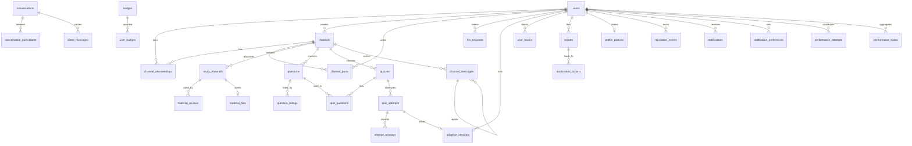

# Architecture

The API is a modular monolith: one FastAPI process and one database, split into
feature modules under `app/modules/`. Each module can change on its own as long as its
public service interface keeps its promises (NFR-07).

## Module rules

1. A module **owns its tables**. Its `models.py` defines them and only that module
   reads or writes them.
2. A module **exposes one public interface**, `service.py`. The functions there return
   plain dataclasses (for example `QuestionView`, `AttemptResult`), never ORM objects,
   so callers cannot reach into another module's data.
3. A module may import `app.core`, its own package, and the `service` of the modules
   listed for it in `app/modules/__init__.py` (`ALLOWED_DEPENDENCIES`). Nothing else.
4. Tables may reference other modules' tables through foreign keys; that needs no
   Python import and keeps referential integrity in the database.

`tests/test_module_boundaries.py` fails the build if any of these rules is broken.

## Modules

| Module | Requirements | Owns tables | May call |
| --- | --- | --- | --- |
| accounts | FR-01 | users, profile_pictures | – |
| channels | FR-02, FR-03 | channels, channel_memberships, channel_posts | accounts |
| materials | FR-04 | study_materials, material_files, material_reviews | accounts, channels, moderation, reputation |
| questions | FR-05, FR-07 | questions, question_ratings | accounts, channels, moderation, reputation |
| quizzes | FR-05, FR-06, FR-07 | quizzes, quiz_questions, quiz_attempts, attempt_answers | accounts, channels, questions |
| llm | FR-07, FR-08, FR-09 | llm_requests, adaptive_sessions | accounts, channels, questions, quizzes |
| chat | FR-10, FR-11 | channel_messages, conversations, conversation_participants, direct_messages, user_blocks | accounts, channels, moderation |
| analytics | FR-12 | performance_attempts, performance_topics (rebuildable from quiz attempts) | accounts, quizzes |
| moderation | FR-13, FR-14 | reports, moderation_actions | – |
| reputation | FR-01, FR-13 | reputation_events, badges, user_badges | accounts |
| notifications | FR-14 | notifications, notification_preferences | – |
| profiles | FR-01 | none (assembled from other modules' services) | accounts, materials, questions, quizzes, reputation |

The web UI (`app/web/`, UI-1) is not a module. It is static files served at `/app/`
that call the public `/api/v1` endpoints like any other client, so it owns no tables and
imports no module code. See `app/web/README.md`.

Routes that need a signed-in user or a permission use the guards exported by
`app.modules.accounts.service` (`current_user`, `require_capability`,
`require_roles`); see `app/modules/accounts/README.md`. A module adding its first
guarded route adds `accounts` to its `ALLOWED_DEPENDENCIES` entry. That keeps the
dependency graph honest: chat's guard on accounts gives quizzes no path to chat.

LLM features (S07.1 onward) go through `app/modules/llm/provider.py`. `LLM_PROVIDER`
selects `openai`, `anthropic`, the offline deterministic `fake`, or `none` (features
answer 503). Model output is validated in `generation.py` (shape, answer key and
subject/topic/difficulty tags) before anything is stored, and generated questions are
stored as drafts that no bank, search or quiz can see until their requester approves
them. The llm module guards its routes with accounts and checks channel-bank
membership with channels; neither path reaches chat.
Ask AI (S09.1, `assistant.py`) explains concepts and builds topic quizzes; its quiz
questions come from the same generation path, so they stay review-gated drafts.
Descriptive answer evaluation (S08.1, `evaluation.py`) uses the same provider and
validates the model's score and concept lists against the question before returning
them; with no real model it falls back to deterministic concept matching.

Quiz scoring lives in `app/modules/quizzes/scoring.py` as pure functions. No module
that quizzes depends on can reach chat, so a change to chat can never require a change
to scoring (checked by `test_quiz_scoring_does_not_depend_on_chat` and
`test_chat_activity_does_not_change_quiz_scores`).

Performance analytics (S12.1) keeps stored figures without making quizzes depend on
analytics: quizzes publishes `quizzes.attempt_scored` through the in-process event hub
in `app/core/events.py`, and analytics subscribes to it. Handlers run in the
publisher's transaction, so an attempt and its analytics figures commit together.
Analytics also reconciles the figures with the raw attempts before the dashboard is
read, so a missed event can never leave them wrong. See
`app/modules/analytics/README.md`.

Cross-cutting references that point at "any content" (a shared resource in a chat
message, the target of a report) are stored as a type plus an id rather than a
foreign key, so the owning modules stay independent.

## Data model

## Migrations and seed data

Schema changes are Alembic migrations in `alembic/versions/`. Every migration must
upgrade and downgrade cleanly on an empty database and leave the schema identical to
the models; `tests/test_migrations.py` checks this on SQLite and, in CI, PostgreSQL.

`python -m app.seed` loads one user per role (student, authorized user, admin), a
peer channel, an approved authorized channel, materials, questions, a quiz with one
scored attempt, chat messages and a reputation event. The users' password comes from
`SEED_USER_PASSWORD`, or is generated and printed once.

## API contract

The API is versioned under `/api/v1`. The OpenAPI document for v1 is committed at
`docs/api/openapi-v1.json`; regenerate it with `python scripts/export_openapi.py`
after changing any route. CI fails when the committed contract and the code differ,
so every API change is visible in review. A breaking change gets a new version prefix
and a new contract file rather than editing v1 in place.
