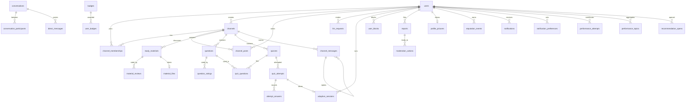

# Architecture

The API is a modular monolith: one FastAPI process and one database, split into
feature modules under `app/modules/`. Each module can change on its own as long as its
public service interface keeps its promises (NFR-07).

## Module rules

1. A module **owns its tables**. Its `models.py` defines them and only that module
   reads or writes them.
2. A module **exposes one public interface**, `service.py`. The functions there return
   plain dataclasses (for example `QuestionView`, `AttemptResult`), never ORM objects,
   so callers cannot reach into another module's data.
3. A module may import `app.core`, its own package, and the `service` of the modules
   listed for it in `app/modules/__init__.py` (`ALLOWED_DEPENDENCIES`). Nothing else.
4. Tables may reference other modules' tables through foreign keys; that needs no
   Python import and keeps referential integrity in the database.

`tests/test_module_boundaries.py` fails the build if any of these rules is broken.

## Modules

| Module | Requirements | Owns tables | May call |
| --- | --- | --- | --- |
| accounts | FR-01 | users, profile_pictures | – |
| channels | FR-02, FR-03 | channels, channel_memberships, channel_posts | accounts, moderation, notifications |
| materials | FR-04 | study_materials, material_files, material_reviews | accounts, channels, moderation, reputation |
| questions | FR-05, FR-07 | questions, question_ratings | accounts, channels, moderation, reputation |
| quizzes | FR-05, FR-06, FR-07 | quizzes, quiz_questions, quiz_attempts, attempt_answers | accounts, channels, questions |
| llm | FR-07, FR-08, FR-09 | llm_requests, adaptive_sessions | accounts, channels, moderation (filing reports on AI output, NFR-06), questions, quizzes |
| chat | FR-10, FR-11 | channel_messages, conversations, conversation_participants, direct_messages, user_blocks | accounts, channels, materials, moderation, questions, quizzes (preview cards for shared resources, S11.2) |
| analytics | FR-12 | performance_attempts, performance_topics (rebuildable from quiz attempts), recommendation_opens | accounts, channels, materials, questions, quizzes |
| moderation | FR-13, FR-14 | reports, moderation_actions | – |
| moderation_queue | FR-13 | none (the S13.2 report queue and moderator actions, assembled from other modules' services) | accounts, channels, llm (AI responses in the queue, NFR-06), materials, moderation, questions |
| reputation | FR-01, FR-13 | reputation_events, badges, user_badges | accounts |
| notifications | FR-14 | notifications, notification_preferences | accounts (reacts to chat, channels and quizzes through events) |
| profiles | FR-01 | none (assembled from other modules' services) | accounts, materials, questions, quizzes, reputation |
| admin | FR-14 | none (audit log is moderation's `moderation_actions`) | accounts, channels, materials, moderation, notifications, questions |

The web UI (`app/web/`, UI-1; UI-2 adds the materials, question bank and quiz screens
in `static/study.js`) is not a module. It is static files served at `/app/`
that call the public `/api/v1` endpoints like any other client, so it owns no tables and
imports no module code. See `app/web/README.md`.

Routes that need a signed-in user or a permission use the guards exported by
`app.modules.accounts.service` (`current_user`, `require_capability`,
`require_roles`); see `app/modules/accounts/README.md`. A module adding its first
guarded route adds `accounts` to its `ALLOWED_DEPENDENCIES` entry. That keeps the
dependency graph honest: chat's guard on accounts gives quizzes no path to chat.

LLM features (S07.1 onward) go through `app/modules/llm/provider.py`. `LLM_PROVIDER`
selects `openai`, `anthropic`, the offline deterministic `fake`, or `none` (features
answer 503). Model output is validated in `generation.py` (shape, answer key and
subject/topic/difficulty tags) before anything is stored, and generated questions are
stored as drafts that no bank, search or quiz can see until their requester approves
them. The llm module guards its routes with accounts and checks channel-bank
membership with channels; neither path reaches chat.
Ask AI (S09.1, `assistant.py`) explains concepts and builds topic quizzes; its quiz
questions come from the same generation path, so they stay review-gated drafts.
Descriptive answer evaluation (S08.1, `evaluation.py`) uses the same provider and
validates the model's score and concept lists against the question before returning
them; with no real model it falls back to deterministic concept matching.

## LLM reliability (NFR-06)

- **Review gate.** `questions.create_question` stores every `source=llm` question as a
  draft, and every reader of the bank, quiz builder and `quizzes.publish` accepts
  published questions only. Generation, Ask AI and Ask AI in a channel all go through
  that path, so no generated question reaches a bank or a published quiz until its
  requester approves it on the review screen (`/ai/generations/{id}`).
- **Reporting.** Each AI output is one `llm_requests` row and its id is on the
  response (`id` of an Ask AI answer or a generated batch, `ai_response_id` of an LLM
  evaluation). `POST /ai/responses/{id}/reports` files a `reports` row with
  `target_type = ai_response`, scoped to the request's channel, so it appears in the
  same moderation queue as materials and questions, marked `ai_generated` with an
  excerpt of the output. AI questions already in a bank are reported as questions and
  marked `ai_generated` too. Upholding the report (Remove Content) sets
  `llm_requests.withdrawn`: the topic quiz can no longer be started and the review
  screen closes. llm files the report through moderation's service; the queue reads the
  output through llm's service. Neither path reaches chat.
- **Deterministic scoring.** See below; `tests/test_llm_reliability.py` also scores a
  quiz with a provider that fails on any call and checks that nothing quizzes may call
  can reach llm.

Quiz scoring lives in `app/modules/quizzes/scoring.py` as pure functions. No module
that quizzes depends on can reach chat, so a change to chat can never require a change
to scoring (checked by `test_quiz_scoring_does_not_depend_on_chat` and
`test_chat_activity_does_not_change_quiz_scores`).

Performance analytics (S12.1) keeps stored figures without making quizzes depend on
analytics: quizzes publishes `quizzes.attempt_scored` through the in-process event hub
in `app/core/events.py`, and analytics subscribes to it. Handlers run in the
publisher's transaction, so an attempt and its analytics figures commit together. Each
handler runs in its own savepoint, so a failing handler undoes only its own writes and
never the attempt (NFR-04).
Analytics also reconciles the figures with the raw attempts before the dashboard is
read, so a missed event can never leave them wrong. See
`app/modules/analytics/README.md`.

Notifications (S14.1) use the same hub so that nothing has to depend on notifications:
chat publishes `chat.channel_message_posted` (with who a message replies to and which
members it @mentions), channels publishes `channels.post_created` and quizzes publishes
`quizzes.quiz_published`, each carrying the recipients; notifications subscribes and
writes a notification for each recipient who has not switched that category off. The
event names live in `app/core/events.py`. See `app/modules/notifications/README.md`.

Cross-cutting references that point at "any content" (a shared resource in a chat
message, the target of a report) are stored as a type plus an id rather than a
foreign key, so the owning modules stay independent.

## Security (NFR-02)

- **Credentials.** Passwords are hashed with salted scrypt (`app/core/security.py`,
  N=2^14, r=8, 16-byte salt) and compared in constant time. No response model has a
  password field; the hash never leaves the accounts module.
- **Authentication.** Every route except the public list (health, register, login,
  session policy, profile pictures) depends on `accounts.service.current_user`, which
  verifies an HS256 bearer token signed with `AUTH_TOKEN_SECRET` and re-reads the account
  on every request, so suspension or a role change applies at once.
- **Role authorization.** Routes declare the capability they need with
  `require_capability` (`app/modules/accounts/permissions.py`); a role without it gets
  403 `Unauthorized`.
- **Resource authorization.** Ownership and membership (my attempt, my draft, my
  conversation, a channel's members, official content) are checked in each module's
  service before anything changes; a private resource answers 404, a visible one 403.

`tests/test_security.py` checks this across the whole published contract: a route that
appears without bearer security, or a role guard that admits a role it should not,
fails the build.

## Reliability (NFR-04)

- **One transaction per request.** `get_db` gives each request one session and rolls
  it back if the request fails; routes commit once, after all their work. An upload
  (material, tags and file bytes, which live in `material_files`) and a submission
  (answers, scores, attempt state and analytics figures) each commit together or not
  at all, so a crash or dropped connection part-way leaves the last committed state.
- **Transient failures.** A database `OperationalError` answers **503** with a message
  saying nothing from the request was saved and earlier work is safe; the client
  retries the same request.
- **Isolated reactions.** Event handlers (analytics, notifications) run in savepoints:
  a bug in one is logged and undone without failing the submission or upload that
  triggered it. Analytics reconciles its figures with the stored attempts on read. A
  database failure inside a handler still rolls the whole request back.
- **Stored file integrity.** Each material file keeps the SHA-256 taken at upload
  (migration `0013` backfills existing files). The upload response returns it, the
  download sends it as `X-Content-SHA256`, and a file whose bytes no longer match is
  refused rather than served damaged.

`tests/test_reliability.py` checks all of this by fault injection: it kills a process
running the real app mid-submission and mid-upload, injects transient failures, and
reopens the database as a restarted server would.

## Scalability (NFR-05)

Performance has to hold as users and content grow. Three rules keep it that way, and
`tests/test_scalability.py` checks each one against a seeded dataset at both ends of
the tested range (`scripts/seed_scale.py`: factor 1 is 50 users, 500 materials and
about 1,100 channel messages; factor 10 is 500 users, 5,000 materials, 11,000 channel
messages, 10,000 direct messages, 10,000 notifications and 2,000 quiz attempts).

- **Every hot path answers inside its target at both ends of the range.** The target
  is NFR-01's 1 second (search and filter), applied to the dashboard, chat history,
  quiz start and submit, the moderation queue and the other paths listed in the test.
- **Queries per request do not grow with the data.** A list looks related rows up
  with one batched query (`accounts.get_users`, `channels.describe_channels`,
  `channels.member_roles`, `materials.get_materials`, `questions.get_question_owners`,
  `chat.blocks_involving`), never one query per row. Long lists are paged (materials,
  the question bank, chat and direct messages, notifications, reviews).
- **Hot queries are answered from an index.** The test runs every hot path's queries
  through SQLite's query planner and fails on a full table scan of a growing table;
  the two intended scans (the leaderboard aggregate, the admin dashboard's account
  counts) are listed with their reason. Every foreign key column is indexed too,
  because PostgreSQL does not index them itself and joins and cascading deletes
  follow them. Migration `0014` added the missing ones.

To re-run the suite against a real database: `alembic upgrade head`, then
`SEED_USER_PASSWORD=... python -m scripts.seed_scale --factor 10`, and drive the API
as `scale_probe` (student) or `scale_admin`. Use a throwaway database, never production.

Known limits: the admin user list (`GET /api/v1/admin/users`, `GET
/api/v1/accounts/admin/users`) and a quiz list (`GET /api/v1/quizzes`) return every
row in one response. Each is a fixed couple of queries at any size, so they pass the
suite, but the payload grows with the number of accounts or quizzes; they need paging
(and a matching UI change) before the platform holds tens of thousands of either.

### Adding a domain

A new feature domain is a new module; nothing existing has to be redesigned:

1. Create `app/modules/<name>/` with `models.py` (its own tables), `service.py` (the
   dataclass interface) and `router.py`, and register the models in `app/models.py`.
2. Add `"<name>": {...}` to `ALLOWED_DEPENDENCIES` with the services it calls, and a
   row to the module table above. The dependency graph has no cycles
   (`test_NFR_05_module_dependencies_form_layers_a_new_module_can_sit_on`), so a new
   module can sit on top of any existing service without that module changing.
3. Add its routers to `MODULE_ROUTERS` in `app/main.py` (mounted under `/api/v1`)
   and regenerate the contract and `docs/modules.md`.
4. Add a migration for its tables and an index on each foreign key.

Modules that need to react to another module's activity subscribe to its events
(`app/core/events.py`) instead of the other module calling them, as notifications and
analytics do.

## Maintainability (NFR-07)

Channels, chat, quizzes, the question bank (`questions`), analytics and the LLM
services (`llm`) are separate modules, each with its own tables, service and routes.
Three things let one of them change and deploy without touching the others:

- **One-way dependencies.** A module only calls the services listed for it in
  `ALLOWED_DEPENDENCIES`. Nothing quizzes or questions may call reaches chat,
  analytics or llm, so a chat release can never require an edit to quiz scoring.
- **Selectable modules.** `app/main.py` is the only place that knows every module: it
  lists each module's routers in `MODULE_ROUTERS` and imports them only when that
  module is served. `ENABLED_MODULES` (comma-separated, blank for all) picks what a
  process serves; each named module brings the modules it may call
  (`required_modules`). For example `ENABLED_MODULES=quizzes` serves accounts,
  channels, moderation, notifications, questions, quizzes and reputation, and chat,
  analytics and llm code is never imported. `app.models` loads the tables of the served
  modules only (every set a module brings holds the tables its tables reference);
  Alembic and the seed scripts call `load_models()` for all of them, so there is still
  one migration history and one schema. Web UI screens of a module that is not served
  get 404 from the API.
- **Documented interfaces.** [`docs/modules.md`](modules.md) lists each module's
  tables, allowed callers and callees, events, routes and public service functions and
  dataclasses. It is generated from the code by
  `python scripts/export_module_interfaces.py`, and the build fails if it is out of
  date, so an interface change shows up in review. Every public service function has a
  docstring, and each module's `__init__.py` states the tables it owns.

`tests/test_maintainability.py` checks all of this, including the issue's own
check: it changes chat (schema and behaviour) in a copy of the project and confirms
that chat's tests notice while quiz scoring's tests pass unedited; and it runs quiz
scoring's tests with `ENABLED_MODULES=quizzes` while every unrelated module is made
unimportable.

## Data model

## Migrations and seed data

Schema changes are Alembic migrations in `alembic/versions/`. Every migration must
upgrade and downgrade cleanly on an empty database and leave the schema identical to
the models; `tests/test_migrations.py` checks this on SQLite and, in CI, PostgreSQL.

`python -m app.seed` loads one user per role (student, authorized user, admin), a
peer channel, an approved authorized channel, materials, questions, a quiz with one
scored attempt, chat messages and a reputation event. The users' password comes from
`SEED_USER_PASSWORD`, or is generated and printed once.

## API contract

The API is versioned under `/api/v1`. The OpenAPI document for v1 is committed at
`docs/api/openapi-v1.json`; regenerate it with `python scripts/export_openapi.py`
after changing any route. CI fails when the committed contract and the code differ,
so every API change is visible in review. A breaking change gets a new version prefix
and a new contract file rather than editing v1 in place.
